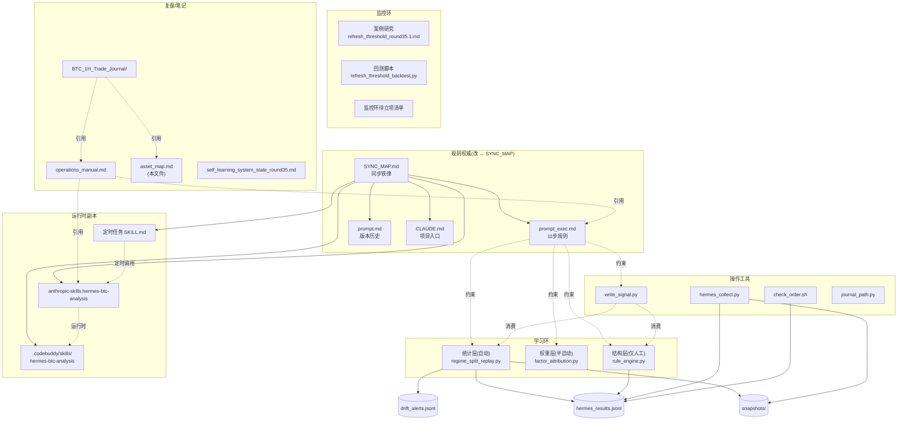
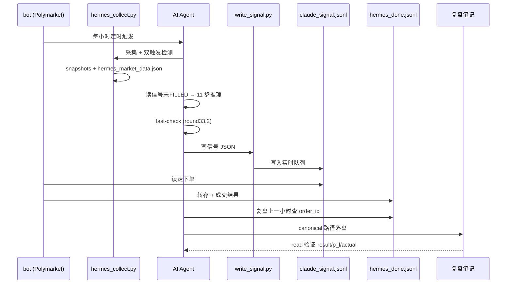
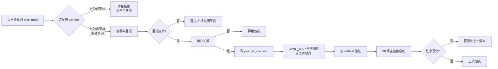

# Hermes BTC 系统资产全景图

> 解决三个问题:**什么在哪里 / 谁管什么 / 改动要走什么流程**

---

## 一、资产清单(8 大类,30+ 件)

### A. 规则权威(谁都不能擅自改)

| 资产 | 位置 | 谁改 | 改的流程 |
|---|---|---|---|
| 11 步规则 | `prompt_exec.md` | 用户拍板 | **SYNC_MAP 全链**(5 文件) |
| 版本历史 | `prompt.md` | 同上 | 同上,版本表新增行 |
| 项目入口 | `CLAUDE.md` | 同上 | 锚点更新 |
| 同步铁律 | `SYNC_MAP.md` | 同上 | 锚点 + 推进记录 |

### B. 学习环-统计层(自动)

| 资产 | 位置 | 用途 | 触发 |
|---|---|---|---|
| 统计执行器 | `scripts/regime_split_replay.py` | 四维拆分 + Wilson + 时间切分 + 漂移告警 | 周日 + 50 场增量 |
| 漂移告警 | `data/drift_alerts.jsonl` | 落盘漂移格子 | 执行器自动写 |
| 引擎查表 | `scripts/rule_engine.py:842` | `_probability()` 四维表 | 同步落表 |
| 已结算 | `data/hermes_results.jsonl` | 答案册(399 场) | bot 自动追加 |
| 快照归档 | `data/snapshots/` | 211 场可复算 | 采集器自动写 |
| 审查报告 | `data/hermes_model_library_review_20260821.md` | 三轮 AI 审查融合归档 | round 抬升时 |

### C. 学习环-权重层(半自动)

| 资产 | 位置 | 用途 | 触发 |
|---|---|---|---|
| 因子归因 | `scripts/factor_attribution.py` | 逐因子判别力聚合 | 阶段 4 启动 |
| 结构化教训 | `data/review-lessons.json` | 200 条对/错因子 | 复盘时自动 |

### D. 学习环-结构层(仅人工)

| 资产 | 位置 | 用途 |
|---|---|---|
| G/H 规则主入口 | `scripts/rule_engine.py` | G1-G6 + H9/H12 硬约束 |
| 校验层 | `scripts/signal_validator.py` | AI 写信号前校验 |
| 候选规则 schema | `docs/hermes_learning_architecture.md §5` | 进队列前必填 |

### E. 监控环(流程审计,非学习)

| 资产 | 位置 | 状态 |
|---|---|---|
| refresh 案例研究 | `docs/case_studies/refresh_threshold_round35.1.md` | ✅ 已验证(0.10% 最优) |
| refresh 回测脚本 | `scripts/refresh_threshold_backtest.py` | 一次性,非生产 |
| 5pm-et 笔记补遗 | `BTC_1H_Trade_Journal/2026-08-20_1700_复盘.md`(末尾) | ✅ 已落 |
| 监控环待立项清单 | (见下 §四) | ⏳ 待立项 |

### F. 复盘/笔记(自由区)

| 资产 | 位置 | 用途 |
|---|---|---|
| 复盘笔记 | `BTC_1H_Trade_Journal/` | 31 篇 |
| 操作手册 | `docs/operations_manual.md` | 工作流 SOP |
| 学习架构文档 | `docs/hermes_learning_architecture.md` | 三层 + 监控环合约 |
| 状态快照 | `docs/self_learning_system_state_round35.md` | 当前状态 |
| 资产地图 | `docs/asset_map.md` | **本文件** |

### G. 操作工具(高频)

| 资产 | 位置 | 用途 |
|---|---|---|
| 数据采集 | `scripts/hermes_collect.py` | 每小时首步 |
| 写信号 | `scripts/write_signal.py` | 11 步完成后 |
| 订单核对 | `scripts/check_order.sh` | 写信号后 |
| canonical 路径 | `scripts/journal_path.py` | 复盘笔记定位 |
| 环境变量 | `scripts/hermes_env.sh` | 每 bash 首句 source |
| 单步入口 | `scripts/hermes_run.sh` | 自动 cd + source + exec |

### H. 运行时副本(MCP 管理)

| 资产 | 位置 | 锚点 |
|---|---|---|
| 定时任务 | `~/Claude/Scheduled/btc-1h-hourly-analysis-v2/SKILL.md` | round33.2 待同步 |
| 运行时技能 | `anthropic-skills:hermes-btc-analysis`(MCP) | 跟 SYNC_MAP 锚点 |
| 项目技能副本 | `.codebuddy/skills/hermes-btc-analysis/SKILL.md` | round35 ✅ |

---

## 二、关系图(mermaid)

### 2.1 总览(从规则到执行)

### 2.2 数据流(每小时信号全生命周期)

### 2.3 改动流程(改规则要走什么)

---

## 三、改动权限矩阵

| 改什么 | 谁有权 | 怎么改 | 谁验证 |
|---|---|---|---|
| `prompt_exec.md` 规则 | 用户拍板 | Edit 文件 | selftest + 监控窗 |
| `scripts/rule_engine.py` | 用户拍板 | Edit + selftest | 双 selftest + 监控窗 |
| 复盘笔记 | AI 自动 | Write/Edit | read 验证 result/p_l/actual |
| 案例研究 | AI 自动(归档时) | Write | 用户 review |
| 漂移告警 | 统计执行器自动写 | append | 周日人肉消费 |
| 候选规则 schema | 写入架构文档 | Edit 架构文档 | 用户 review |
| 定时任务 | MCP 管理 | 用户在 Claude desktop 改 | 锚点回读 |
| 操作手册 | AI 自动 | Write/Edit | 用户 review |
| 资产地图 | AI 自动(本文件) | Write/Edit | 用户 review |

---

## 四、监控环待立项清单(round35.1 后)

| 议题 | 状态 | 优先级 |
|---|---|---|
| AI 手算 vs 引擎机算一致性检测 | **待立项**(5pm-et 真问题) | 🔥 高 |
| 候选方案 A:写信号前强制 engine 重算校验 | 待写提案 | 🟡 |
| 候选方案 B:贴线抖动场快速 5 步推理 | 待写提案 | 🟡 |
| 候选方案 C:信号 JSON 加 engine_verified_direction | 待写提案 | 🟡 |

**为什么不是"立刻做"**: 这三个方案都涉及 `scripts/write_signal.py` 改动,属**结构层**(仅人工)。需要:
1. 写反事实验证任一方案能否救场
2. 用户拍板选哪个
3. 走 SYNC_MAP 全链 + selftest + 监控窗

---

## 五、待办(下一轮动作)

| 触发条件 | 动作 | 谁做 |
|---|---|---|
| 周日 | 跑 `regime_split_replay.py` 看告警 | AI/用户 |
| 0-2 档监控窗累计 30 场 | 验证 round35 落表稳定性 | AI 自动盯 |
| 0-2 档胜率 < 51.5% | 触发回滚到 round34.1 | AI 提,用户拍 |
| 31 天后(全结算 1000 场) | 启动阶段 4 准备 | 用户拍板 |
| 78 天后(可复算 1000 场) | walk-forward benchmark | 用户拍板 |
| 监控环立项时机 | 任一 push back 提到 AI vs 引擎 | AI 提方案,用户选 |

---

## 六、文件速查索引(按使用频率)

### 🔴 每小时用(分析师必读)
- `scripts/hermes_collect.py` — 采集
- `scripts/write_signal.py` — 写信号
- `scripts/check_order.sh` — 核对
- `scripts/journal_path.py` — canonical

### 🟡 每周用
- `scripts/regime_split_replay.py` — 周日体检

### 🟢 一次性/归档用
- `scripts/refresh_threshold_backtest.py` — refresh 阈值回测(已验证)
- `docs/case_studies/refresh_threshold_round35.1.md` — 案例研究

### ⚪ 接手必读(5 分钟)
- `CLAUDE.md` — 项目入口
- `docs/operations_manual.md` — 工作流 SOP
- `docs/self_learning_system_state_round35.md` — 当前状态
- `docs/asset_map.md` — **本文件**(全景图)
- `docs/hermes_learning_architecture.md` — 架构合约

---

## 七、维护纪律

1. **新增资产** → 必须更新本文件(本节 §一清单 + §二关系图)
2. **改任何规则** → 必须更新 §三权限矩阵
3. **round 抬升** → 必须更新 §五待办(触发条件 + 动作)
4. **每月体检**: 跑 §六 + 检查 §四 + 验证 §一资产清单

---

**维护者**: 用户 + AI agent
**下次更新触发**: 监控环立项 / round36 落表 / 阶段 4 启动 / 资产新增或删除 之一发生。